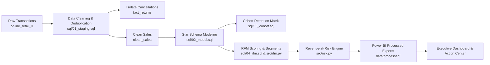

# Customer Retention & Revenue-at-Risk Analysis

> **Portfolio-Grade Analytics Project** answering the core executive question:  
> *"Which customers are we about to lose, how much revenue is at risk, and what should we do about it?"*

[](https://www.python.org/)
[](https://duckdb.org/)
[](https://powerbi.microsoft.com/)
[](https://pytest.org/)

---

## 1. Executive Summary & Business Problem

Customer acquisition costs 5x more than retention. For an online retailer with repeat purchasing behavior, undetected customer churn silently drains revenue before high-level top-line metrics flag the danger.

This project delivers an end-to-end analytical framework on the **Online Retail II dataset (UCI)** spanning 2 years of non-store transactions:
- **Diagnoses churn dynamics** via monthly cohort retention curves.
- **Segments active and declining customers** using behavioral RFM quintiles.
- **Quantifies annualized Revenue-at-Risk** and models realistic win-back recovery scenarios.
- **Delivers an operational top-50 prioritized account action list** ready for marketing and sales outreach.

---

## 2. Key Results (Audit-Traceable Figures)

All metrics are reconciled to the penny across DuckDB star schema tables (`fact_orders`, `dim_customer`, `customer_rfm`):

| Metric | Computed Value | Description |
| :--- | :--- | :--- |
| **Total Tracked Revenue** | **£17,081,128.74** | Reconciled merchandise revenue from clean customer transactions |
| **Analyzed Customer Base** | **5,853 accounts** | Unique identified customer accounts across 2 years |
| **Repeat Customer Rate** | **72.34%** | 4,234 out of 5,853 customers placed $\ge 2$ distinct orders |
| **Champions Revenue Share** | **68.46% (£11.69M)** | 1,390 accounts generating over two-thirds of total turnover |
| **Historical Spend (At Risk & Can't Lose)** | **£1,527,683.97** | Lifetime historical revenue from 710 At Risk and Can't Lose Them accounts |
| **Annualized Revenue-at-Risk** | **£886,993.14** | Annual run-rate exposure across 710 accounts (8.51% of customer base EAV) |
| **Pareto Concentration** | **77.17% (£13.18M)** | Generated by the top 20% of customer accounts (1,171 accounts) |

---

## 3. Cohort Retention Benchmarks & Churn Dynamics

Customer cohorts are defined by each account's first order month. To isolate genuine organic customer behavior, benchmarks exclude both the **Dec 2009 legacy cohort** (which contains existing pre-dataset customers) and the **Dec 2011 partial cohort** (truncated at Dec 9 with zero retention runway):

### Organic Retention Benchmarks (Excluding Dec 2009 & Dec 2011 Cohorts)
| Horizon | Evaluated Cohorts | Unweighted Average | Customer-Weighted Average | Total Active / Total Cohort Customers |
| :---: | :---: | :---: | :---: | :---: |
| **Month 1** | 22 cohorts | **20.66%** | **20.97%** | 982 / 4,683 customers |
| **Month 3** | 20 cohorts | **21.02%** | **21.08%** | 901 / 4,274 customers |
| **Month 6** | 17 cohorts | **17.32%** | **18.44%** | 730 / 3,958 customers |
| **Month 12** | 11 cohorts | **17.92%** | **18.43%** | 606 / 3,289 customers |

*(Customer-weighted average $=\sum \text{Active Customers} / \sum \text{Cohort Size}$.)*

### Key Cohort Observations
1. **The 30-Day Drop-Off:** Retention means **bought in that specific month**, not "never returned." Across organic cohorts, **about 4 in 5 new customers don't buy in the very next month** (Month 1 retention averages ~21%, meaning ~79% do not make an immediate repeat purchase in Month 1, though some return in later months).
2. **The 18% Stable Floor:** After the initial drop, retention flattens into an enduring baseline of **~18%** through Month 6 and Month 12. This stable core represents the repeat habitual buyers driving the bulk of sales.
3. **Cohort Size Consistency:** Customer acquisition averaged ~200–250 new accounts per month, with seasonal surges in September–November.


---

## 4. RFM Segmentation & Revenue Concentration

Using the centrally configured snapshot date (**2011-12-10**), customers are scored across Recency ($R$), Frequency ($F$), and Monetary ($M$) dimensions:
- **Recency ($R$) & Monetary ($M$):** Scored 1–5 using quintiles (`NTILE(5)`), where 5 indicates most recent purchase and highest spend.
- **Frequency ($F$):** Scored 1–5 using **fixed integer bands** (`1, 2, 3-4, 5-9, 10+`) to eliminate arbitrary tie-breaking across discrete order counts:
  - *1 order (Score 1):* 1,619 customers (27.66%, £556,725 revenue)
  - *2 orders (Score 2):* 945 customers (16.15%, £807,675 revenue)
  - *3–4 orders (Score 3):* 1,148 customers (19.61%, £1,459,903 revenue)
  - *5–9 orders (Score 4):* 1,180 customers (20.16%, £2,873,094 revenue)
  - *10+ orders (Score 5):* 961 customers (16.42%, £11,383,732 revenue)

### Segment Definitions & Distribution (Ordered Rules, First Match Wins)
| Segment | Scoring Criteria | Customers | % Customers | Revenue (£) | % Revenue | Avg Recency | Avg Frequency | Avg Order Value |
| :--- | :--- | :---: | :---: | :---: | :---: | :---: | :---: | :---: |
| **Champions** | $R \ge 4 \ \&\ F \ge 4$ | 1,388 | 23.71% | £11,676,846.76 | 68.36% | 20.1 days | 16.2 orders | £415.25 |
| **Loyal** | $R \ge 3 \ \&\ F \ge 3$ | 1,191 | 20.35% | £2,512,599.24 | 14.71% | 76.7 days | 5.6 orders | £366.37 |
| **Can't Lose Them** | $R \le 2 \ \&\ F \ge 4$ | 287 | 4.90% | £952,297.58 | 5.58% | 338.3 days | 8.6 orders | £359.02 |
| **Hibernating/Lost** | $R \le 2 \ \&\ F \le 2$ | 1,632 | 27.88% | £691,967.71 | 4.05% | 454.1 days | 1.3 orders | £327.26 |
| **At Risk** | $R \le 2 \ \&\ F \ge 3$ | 423 | 7.23% | £574,985.10 | 3.37% | 374.3 days | 3.4 orders | £412.38 |
| **New/Promising** | $R \ge 4 \ \&\ F \le 2$ | 511 | 8.73% | £443,209.49 | 2.59% | 27.8 days | 1.5 orders | £511.53 |
| **Need Attention** | *All others* | 421 | 7.19% | £229,222.85 | 1.34% | 107.7 days | 1.4 orders | £392.10 |
| **Total / Overall** | *Entire base* | **5,853** | **100.00%** | **£17,081,128.74** | **100.00%** | **202.4 days** | **6.3 orders** | **£390.69** |

### Visualizing RFM Segments & Pareto Concentration


### 3 Plain-English Observations from the Real Numbers
1. **The 80/20 Rule Holds Firm (Extreme Revenue Concentration):**  
   The top 20% of customers (1,171 accounts) generate **77.17% of total revenue** (£13.18M out of £17.08M). Furthermore, Champions alone (23.7% of customers) deliver 68.36% of all revenue (£11.68M) with an average purchasing frequency of 16.2 orders. Protecting these relationships is paramount.
2. **Historical Spend Concentration in Dormant Accounts:**  
   There is **£1.53M in historical revenue from At Risk and Can't Lose Them customers** (710 accounts total). This represents past cumulative spend, not future annual revenue at risk. A meaningful portion of these high-value accounts have not purchased in nearly a year (average recency of ~340–375 days).
3. **The "One-and-Done" Trialist Trap vs. Power Buyers:**  
   Over 27.6% of the customer base (1,619 accounts) placed exactly one order, generating just 3.26% of revenue. In contrast, power buyers with 10+ orders represent only 16.4% of accounts but generate two-thirds (66.65%, £11.38M) of all revenue. This confirms that acquiring new customers yields negligible returns unless nurtured through second and third repeat purchases.

---

---

## 5. Revenue-at-Risk & Win-Back Scenarios

### Core Definitions
The following definitions are applied verbatim across the pipeline:

```text
expected_annual_value = total_revenue / MAX(1, years since first order)
(years measured to the snapshot date)
is_at_risk = segment is 'At Risk' or 'Can't Lose Them'
Revenue-at-Risk = SUM(expected_annual_value) for is_at_risk customers
Revenue-at-Risk % = Revenue-at-Risk / SUM(expected_annual_value) for all customers
```

### 1. Revenue-at-Risk Summary Table (`revenue_at_risk_summary.csv`)
Across the entire customer base of 5,853 accounts, total Expected Annual Value (EAV) is **£10,420,530.94**. Of this, **£886,993.14 (8.51%)** is at risk across 710 dormant high-value accounts:

| Segment | Customers | % Customers | Historical Spend (£) | Revenue-at-Risk (£) | Revenue-at-Risk % | Avg Recency | Suggested Strategy |
| :--- | :---: | :---: | :---: | :---: | :---: | :---: | :--- |
| **Can't Lose Them** | 287 | 4.90% | £952,698.87 | £516,432.19 | 4.96% | 338.3 days | personal call + loyalty offer |
| **At Risk** | 423 | 7.23% | £574,985.10 | £370,560.95 | 3.56% | 374.3 days | win-back email with a discount |
| **Total Revenue-at-Risk** | **710** | **12.13%** | **£1,527,683.97** | **£886,993.14** | **8.51%** | **359.8 days** | Prioritized Account Outreach |

### 2. Win-Back Scenarios Sensitivity Matrix (`win_back_scenarios.csv`)
Sensitivity analysis evaluates recovered revenue across three recovery benchmarks (5%, 10%, 15%) against customer segment scopes:
*(Label: scenario assumptions, not forecasts)*

| Recovery Rate | Can't Lose Them Only (287 accounts) | At Risk Only (423 accounts) | Both Combined (710 accounts) | Scenario Label |
| :---: | :---: | :---: | :---: | :--- |
| **5% Recovery** | £25,821.61 | £18,528.05 | **£44,349.66** | scenario assumptions, not forecasts |
| **10% Recovery** | £51,643.22 | £37,056.10 | **£88,699.31** | scenario assumptions, not forecasts |
| **15% Recovery** | £77,464.83 | £55,584.14 | **£133,048.97** | scenario assumptions, not forecasts |

*Key Takeaway:* Reclaiming just **10%** of both at-risk segments returns **£88.7k annually**, while recovering 15% yields **£133.0k** in high-margin repeat revenue.

### 3. Prioritized Top 50 Action List (`action_list.csv`)
An operational action list was exported by sorting all at-risk accounts by `expected_annual_value` descending:
- **Outsized Concentration:** The top 50 accounts alone generate **£381,007.79** in expected annual value (**42.96%** of total enterprise Revenue-at-Risk).
- **Segment Outreach Strategy:**
  - `Can't Lose Them` (41 of top 50 accounts): Assigned **"personal call + loyalty offer"** (high lifetime frequency warrants direct high-touch phone outreach by senior account managers).
  - `At Risk` (9 of top 50 accounts): Assigned **"win-back email with a discount"** (moderate historical frequency best engaged via high-margin automated email re-engagement).

#### Top 10 Accounts at Risk (Action Preview)
| Customer ID | Country | Segment | Last Order Date | Recency Days | Orders | Lifetime Revenue | Expected Annual Value | Suggested Action |
| :---: | :--- | :--- | :---: | :---: | :---: | :---: | :---: | :--- |
| `15749` | United Kingdom | At Risk | 2011-04-18 | 236 | 3 | £44,534.30 | **£44,534.30** | win-back email with a discount |
| `12346` | United Kingdom | At Risk | 2011-01-18 | 326 | 3 | £77,352.96 | **£43,570.73** | win-back email with a discount |
| `16754` | United Kingdom | Can't Lose Them | 2010-12-02 | 373 | 29 | £65,500.07 | **£37,239.14** | personal call + loyalty offer |
| `13093` | United Kingdom | Can't Lose Them | 2011-03-09 | 276 | 55 | £54,144.25 | **£26,851.43** | personal call + loyalty offer |
| `17850` | United Kingdom | Can't Lose Them | 2010-12-02 | 373 | 155 | £51,208.87 | **£25,430.26** | personal call + loyalty offer |
| `13902` | Denmark | Can't Lose Them | 2010-03-17 | 633 | 5 | £34,023.26 | **£17,128.95** | personal call + loyalty offer |
| `12482` | Sweden | Can't Lose Them | 2010-05-12 | 577 | 27 | £21,941.72 | **£12,245.76** | personal call + loyalty offer |
| `15808` | United Kingdom | Can't Lose Them | 2011-02-06 | 307 | 21 | £17,180.25 | **£8,485.51** | personal call + loyalty offer |
| `17448` | United Kingdom | Can't Lose Them | 2010-06-28 | 530 | 41 | £14,448.67 | **£8,163.72** | personal call + loyalty offer |
| `13564` | United Kingdom | Can't Lose Them | 2010-12-20 | 355 | 36 | £15,880.22 | **£7,854.04** | personal call + loyalty offer |

### Visualizing Revenue-at-Risk & Recovery Potential


---

## 6. Tech Stack

- **SQL Engine:** DuckDB (fast, file-based embedded in-process OLAP SQL database)
- **Data Engineering & Analysis:** Python 3.11+, pandas, NumPy
- **Visualizations:** Matplotlib, Seaborn
- **Automated Testing:** Pytest (29 automated tests verifying reconciliation, boundaries, and logic)
- **Business Intelligence:** Power BI (interactive 2-page dashboard: Executive Overview & Action Center)

---

## 7. Repository Structure

```
customer-retention-revenue-at-risk/
├── data/
│   ├── raw/                  # Immutable raw transaction dataset (git-ignored)
│   └── processed/            # Reconciled CSV tables for Power BI reporting
├── sql/
│   ├── 01_staging.sql        # Ingest, type casting, filtering, and cleaning
│   ├── 02_model.sql          # Star schema: fact_orders, dim_customer, dim_date
│   ├── 03_cohort.sql         # Monthly acquisition cohort retention matrix
│   ├── 04_rfm.sql            # Base customer RFM metrics, scoring & segmentation
│   └── 05_revenue_at_risk.sql # Revenue-at-Risk & win-back scenario calculations
├── src/
│   ├── __init__.py
│   ├── ingest.py             # DuckDB loader handling CSV and multi-sheet XLSX
│   ├── clean.py              # Data hygiene, cancellation isolation, audit logging
│   ├── rfm.py                # RFM quintile scoring and segment rules
│   ├── risk.py               # Expected annual value, at-risk flags, win-back models
│   └── charts.py             # Heatmaps, segment distributions, Pareto & risk charts
├── notebooks/
│   ├── 01_eda.ipynb          # Exploratory Data Analysis & data quality audit
│   └── 02_analysis.ipynb     # Narrative cohort decay & revenue concentration
├── reports/
│   ├── figures/              # Publication-grade PNG charts (300 DPI)
│   ├── data_quality_log.md   # Step-by-step row count audit and exclusions
│   └── insights.md           # Executive summary & metric-driven recommendations
├── tests/
│   └── test_pipeline.py      # Automated Pytest suite (29 data integrity tests)
├── run_pipeline.py           # End-to-end reproducible orchestrator
├── requirements.txt          # Frozen dependencies
├── .gitignore                # Git ignore rules
└── README.md                 # Project documentation
```

---

## 7. Analytical Workflow & Methodology



### Analytical Definitions
1. **Snapshot Date:** Defined centrally as $\max(\text{order\_date}) + 1\text{ day}$ (**2011-12-10**).
2. **Expected Annual Value:**
   $$\text{Expected Annual Value} = \frac{\text{Total Customer Revenue}}{\max(1.0, \text{Years Since First Order})}$$
3. **At-Risk Flag:** Customer belongs to either the `At Risk` ($R \le 2, F \ge 3$) or `Can't Lose Them` ($R \le 2, F \ge 4$) segments.
4. **Revenue-at-Risk:**
   $$\text{Revenue-at-Risk} = \sum_{c \in \text{At-Risk}} \text{Expected Annual Value}_c$$
5. **Win-Back Scenarios:** Recovery models assuming 5%, 10%, and 15% reclaim rates labeled as *scenario assumptions*, not predictive forecasts.

---

## 8. How to Run & Reproduce

### 1. Clone & Set Up Environment
```bash
git clone https://github.com/your-username/customer-retention-revenue-at-risk.git
cd customer-retention-revenue-at-risk
pip install -r requirements.txt
```

### 2. Add Dataset
Place `online_retail_II.csv` in `data/raw/`.

### 3. Run Pipeline
```bash
python run_pipeline.py
```
This executes all staging queries, builds the star schema in DuckDB, generates cohort retention tables, scores RFM segments, exports reconciled CSVs to `data/processed/`, and saves high-resolution charts in `reports/figures/`.

### 4. Run Automated Tests
```bash
pytest -v
```

---

## 9. Power BI Dashboard Preview

*(To be embedded after Power BI build)*

- **Page 1: Executive Overview:** High-level KPIs, cohort retention heatmap matrix, segment revenue contributions, and monthly revenue trends.
- **Page 2: Action Center:** Interactive win-back recovery slider (0–30%), prioritized customer outreach table, and country/segment slicers.

---

## 10. Data Quality, Assumptions & Limitations

- **Dataset Period:** UK-based online gifts and homeware retailer, Dec 2009 – Dec 2011.
- **Assumptions on Deduplication:** Exact duplicate rows across all 8 fields (34,335 records) were identified and removed during staging. In online retail transaction streaming, records sharing identical invoices, line items, timestamps (down to the second), prices, and customer IDs indicate logging re-tries, double-click submissions, or ingestion multi-dumps rather than separate, identical customer orders placed within the exact same second. Removing them prevents artificial inflation of order line items and sales totals.
- **Unregistered Guest Checkouts:** Rows with null `Customer ID` represent guest checkouts and are excluded from customer-level RFM modeling (tracked and reported in `reports/data_quality_log.md`).
- **Non-Product Stock Codes:** Administrative line items (postage fees `POST`/`DOT`, manual adjustments `M`, discounts `D`, bank charges, adjustments, and test codes) are isolated into `fact_non_products` to preserve genuine merchandise basket sizes and retention economics.
- **Wholesale Concentration:** High-volume wholesale orders influence monetary metrics; Pareto distribution is documented to highlight concentration risks.
- **Cancellations:** Invoices starting with `'C'` are separated into `fact_returns` to track return rates without artificially corrupting sales revenue.
- **Seasonality & At-Risk Classification:** Some customers classified as `At Risk` or `Can't Lose Them` may be seasonal buyers (e.g., annual holiday/gift purchasers who only buy in November–December) rather than permanently churned accounts. While their recency exceeds 300+ days, their next expected purchase cycle may simply coincide with specific annual gifting peaks.


