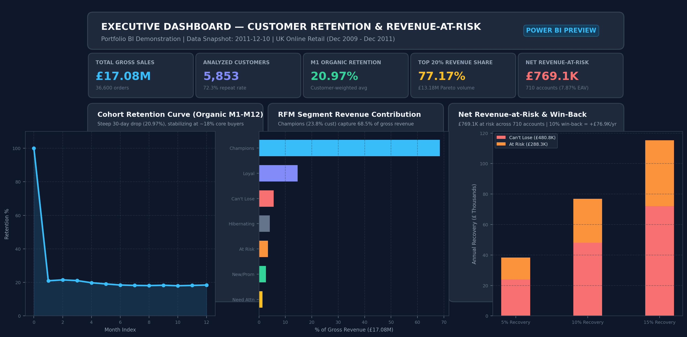

# Customer Retention and Revenue at Risk

I wanted to answer one question a shop owner would really ask: **which of my good customers are quietly leaving, and how much money is that worth?**

For this I used two years of sales from a UK online gift shop. I cleaned the data, found out when customers stop coming back, sorted customers into groups, and put a pound figure on the revenue that is at risk.

<!-- Add your Power BI screenshots here later:


-->

## What I found

- The shop had **5,853 customers** and about **£17.08M in sales** (before returns) from Dec 2009 to Dec 2011.
- Only about **21%** of new customers buy again in the month after their first order. Many of the others come back later, but most don't buy right away.
- The top 20% of customers (1,171 accounts) bring in **77%** of all sales.
- **710 customers** (about 12%) used to buy a lot but have gone quiet. I call them "at risk".
- What they are worth per year is about **£769K**. That is roughly 7.9% of what all customers are worth per year.
- If the shop won back 5%, 10% or 15% of them, that would be about **£38K, £77K or £115K** a year. These are "what if" numbers, not predictions.
- 50 customers hold about 38% of that risk (£289K), so those are the ones to call first.

## The data

The dataset is **Online Retail II** from the UCI Machine Learning Repository. It has 1,067,371 rows. Each row is one line on a receipt: the invoice number, product, quantity, price, date, customer ID and country. Many of the customers are wholesalers.

- UCI: https://archive.ics.uci.edu/dataset/502/online+retail+ii
- Kaggle copy (CSV): https://www.kaggle.com/datasets/mashlyn/online-retail-ii-uci

Credit to the UCI repository for the data. I don't include the raw file in this repo, so you need to download it yourself (see "How to run").

## How I cleaned it

The raw file is messy, so I went step by step and wrote down how many rows I removed or set aside at each step. The full log is in `reports/data_quality_log.md`.

| Step | What I did | Rows |
|---|---|---|
| Start | Raw file | 1,067,371 |
| 1 | Removed exact duplicate rows | 34,335 |
| 2 | Set aside rows with no customer ID (I can't track who they are) | 235,151 |
| 3 | Moved cancelled orders (invoice starts with "C") to their own table | 18,390 |
| 4 | Removed rows with a price of zero or less | 70 |
| 5 | Set aside non-products like postage, bank charges, manual entries and test items | 2,581 |
| End | Clean sales | **776,844** |

That leaves 36,600 orders from 5,853 customers.

About the duplicates: I assumed identical rows (same invoice, product, time and customer) were system repeats and not real double orders. It is an assumption, and removing them lowers sales a little.

## What I did with it

**1. Cohorts.** I grouped customers by the month of their first order and checked how many of them bought again in each month after. On average, about 21% buy in month 1, and around 18% still buy in month 12. There are bumps in October and November, which makes sense for a gift shop. I left out December 2011 because the data stops on 9 December. The December 2009 group is labelled separately because it includes old customers who were already buying before the data starts.

**2. RFM scores.** For each customer I looked at three things: how recently they bought (R), how often (F), and how much they spent (M). Each gets a score from 1 to 5. Many customers have the same number of orders, so for frequency I used fixed bands (1, 2, 3 to 4, 5 to 9, 10 or more) so that customers with the same count always get the same score. Then I put customers into 7 groups:

| Group | Customers | Share of sales |
|---|---|---|
| Champions | 1,390 | 68.5% |
| Loyal | 1,189 | 14.6% |
| Can't Lose Them (big buyers who went quiet) | 287 | 5.6% |
| Hibernating / Lost | 1,632 | 4.1% |
| At Risk (regulars who went quiet) | 423 | 3.4% |
| New / Promising | 509 | 2.6% |
| Need Attention | 423 | 1.3% |

**3. Revenue at risk.** I count a customer as "at risk" if they are in the *Can't Lose Them* or *At Risk* group. To turn that into a yearly number:

- net revenue = what the customer spent minus what they returned (never below £0)
- yearly value = net revenue divided by the years since their first order (at least 1 year)
- revenue at risk = the yearly value of all at-risk customers added up

I use 10 Dec 2011 (the day after the last sale) as "today" for all the "how long ago" maths.

## A mistake I caught

My first version said customer 12346 was my number 2 customer to win back, with about £77,000 spent. Something looked wrong, so I checked. On 18 January 2011 this customer ordered 74,215 jars (£77,183) and **cancelled the whole order the same day**. No money ever came in.

I had moved cancellations into a separate table early on, but I never subtracted them from each customer's spending. Once I did, the revenue at risk dropped from £886,993 to **£769,097**, and customer 12346 fell off the top of the list. I also added a warning flag in the action list for customers who returned more than half of what they bought.

## What I would tell the shop owner

1. **Call the top 50 at-risk customers first.** They hold about 38% of the risk. For the big "Can't Lose Them" accounts, a personal call and a loyalty offer makes sense.
2. **Send the "At Risk" group a win-back email** with a discount.
3. **Help new customers place a second order.** 27.7% of customers bought only once, and only about 1 in 5 buy again the month after their first order.

## What this project can't tell you

- The data is from 2009 to 2011 and is mostly wholesale, so it may not look like a normal shop today.
- There is no cost or profit data, so I can only talk about sales, not profit.
- Some customers might be seasonal buyers who only come back before Christmas. They can look "at risk" when they are just quiet.
- About 22% of rows had no customer ID, so they are not part of the customer analysis (about £2.57M of sales).
- The groups are based on gross spend, but revenue at risk uses net spend after returns.
- When two customers have exactly the same recency, I split them by customer ID. It is repeatable but a bit arbitrary.
- The 5%, 10% and 15% win-back rates are my own assumptions. They are not forecasts.

## How to run it

1. Download the dataset (links above) and save it as `data/raw/online_retail_II.csv`.
2. Create a virtual environment and install the libraries:
   ```
   python -m venv venv
   venv\Scripts\activate
   pip install -r requirements.txt
   ```
   (On Mac or Linux, use `source venv/bin/activate` instead of the second line.)
3. Run everything:
   ```
   python run_pipeline.py
   ```
4. Run the tests:
   ```
   pytest
   ```

The pipeline rebuilds all tables, charts and CSV files from the raw data. I checked it by cloning the repo into a new folder and running it from scratch. All 36 tests passed.

## What is in the repo

```
sql/          the SQL for cleaning, tables, cohorts, RFM and revenue at risk
src/          Python code that runs the SQL and makes the charts and exports
notebooks/    two short notebooks that walk through the data and the results
tests/        36 checks (row counts, revenue totals, one group per customer, etc.)
reports/      data quality log, written insights and charts
data/processed/powerbi/   the CSV files I load into Power BI
run_pipeline.py           runs everything from start to finish
```

## Tools

Python, DuckDB (SQL), pandas, matplotlib, seaborn, pytest and Power BI.

I used an AI coding assistant (Google Antigravity) to help write the code faster. I checked the results myself, compared the totals against the raw data, and fixed the problems I found, like the cancelled order above.

## What I would do next

- Test a win-back offer on a small group before trusting the recovery rates.
- Add cost data so I can estimate profit at risk and not only sales.
- Look at which products the at-risk customers bought, to see if there is a pattern.
