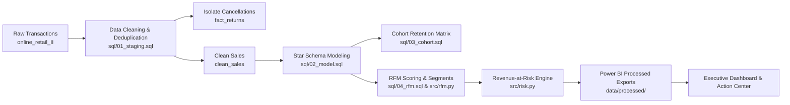

# Customer Retention & Revenue-at-Risk Analysis

> **Portfolio-Grade Analytics Project** answering the core executive question:  
> *"Which customers are we about to lose, how much revenue is at risk, and what should we do about it?"*

[](https://www.python.org/)
[](https://duckdb.org/)
[](https://powerbi.microsoft.com/)
[](https://pytest.org/)

---

## 1. Executive Summary & Business Problem

Customer acquisition costs 5x more than retention. For an online retailer with repeat purchasing behavior, undetected customer churn silently drains revenue before high-level top-line metrics flag the danger.

This project delivers an end-to-end analytical framework on the **Online Retail II dataset (UCI)** spanning 2 years of non-store transactions:
- **Diagnoses churn dynamics** via monthly cohort retention curves.
- **Segments active and declining customers** using behavioral RFM quintiles.
- **Quantifies annualized Revenue-at-Risk** and models realistic win-back recovery scenarios.
- **Delivers an operational top-50 prioritized account action list** ready for marketing and sales outreach.

---

## 2. Key Results (Audit-Traceable Figures)

*(Figures will be computed and populated during pipeline execution)*

| Metric | Computed Value | Description |
| :--- | :--- | :--- |
| **Total Tracked Revenue** | *£TBD* | Reconciled revenue from clean customer transactions |
| **Analyzed Customer Base** | *TBD customers* | Unique identified accounts across 2 years |
| **Revenue-at-Risk** | *£TBD (TBD%)* | Annualized revenue concentrated in high-value decaying segments |
| **Repeat Customer Rate** | *TBD%* | Accounts with $\ge 2$ distinct transactions |
| **10% Win-Back Potential** | *£TBD* | Realistic annual recovery from proactive retention outreach |

---

## 3. Tech Stack

- **SQL Engine:** DuckDB (fast, file-based embedded in-process OLAP SQL database)
- **Data Engineering & Analysis:** Python 3.11+, pandas, NumPy
- **Visualizations:** Matplotlib, Seaborn
- **Automated Testing:** Pytest (verifying financial reconciliation, data types, and business rules)
- **Business Intelligence:** Power BI (interactive 2-page dashboard: Executive Overview & Action Center)

---

## 4. Repository Structure

```
customer-retention-revenue-at-risk/
├── data/
│   ├── raw/                  # Immutable raw transaction dataset (git-ignored)
│   └── processed/            # Reconciled CSV tables for Power BI reporting
├── sql/
│   ├── 01_staging.sql        # Ingest, type casting, filtering, and cleaning
│   ├── 02_model.sql          # Star schema: fact_orders, dim_customer, dim_date
│   ├── 03_cohort.sql         # Monthly acquisition cohort retention matrix
│   ├── 04_rfm.sql            # Base customer RFM metrics
│   ├── 05_segments.sql       # Quantile scoring & rule-based segment assignment
│   └── 06_revenue_at_risk.sql # Revenue-at-Risk & win-back scenario calculations
├── src/
│   ├── __init__.py
│   ├── ingest.py             # DuckDB loader handling CSV and multi-sheet XLSX
│   ├── clean.py              # Data hygiene, cancellation isolation, audit logging
│   ├── rfm.py                # RFM quintile scoring and segment rules
│   ├── risk.py               # Expected annual value, at-risk flags, win-back models
│   └── charts.py             # Heatmaps, segment distributions, and Pareto curves
├── notebooks/
│   ├── 01_eda.ipynb          # Exploratory Data Analysis & data quality audit
│   └── 02_analysis.ipynb     # Narrative cohort decay & revenue concentration
├── reports/
│   ├── figures/              # Publication-grade PNG charts
│   ├── data_quality_log.md   # Step-by-step row count audit and exclusions
│   └── insights.md           # Executive summary & 5 metric-driven recommendations
├── tests/
│   └── test_pipeline.py      # Automated Pytest suite (6+ data integrity tests)
├── run_pipeline.py           # End-to-end reproducible orchestrator
├── requirements.txt          # Frozen dependencies
├── .gitignore                # Git ignore rules
└── README.md                 # Project documentation
```

---

## 5. Analytical Workflow & Methodology



### Analytical Definitions
1. **Snapshot Date:** Defined centrally as $\max(\text{order\_date}) + 1\text{ day}$.
2. **Expected Annual Value:**
   $$\text{Expected Annual Value} = \frac{\text{Total Customer Revenue}}{\max(1.0, \text{Years Since First Order})}$$
3. **At-Risk Flag:** Customer belongs to either the `At Risk` ($R \le 2, F \ge 3$) or `Can't Lose Them` ($R \le 2, F \ge 4$) segments.
4. **Revenue-at-Risk:**
   $$\text{Revenue-at-Risk} = \sum_{c \in \text{At-Risk}} \text{Expected Annual Value}_c$$
5. **Win-Back Scenarios:** Recovery models assuming 5%, 10%, and 15% reclaim rates labeled as *scenario assumptions*, not predictive forecasts.

---

## 6. How to Run & Reproduce

### 1. Clone & Set Up Environment
```bash
git clone https://github.com/your-username/customer-retention-revenue-at-risk.git
cd customer-retention-revenue-at-risk
pip install -r requirements.txt
```

### 2. Add Dataset
Place `online_retail_II.csv` in `data/raw/`.

### 3. Run Pipeline
```bash
python run_pipeline.py
```
This executes all staging queries, builds the star schema in DuckDB, generates cohort retention tables, scores RFM segments, models revenue-at-risk, exports Power BI CSVs to `data/processed/`, and saves high-resolution charts in `reports/figures/`.

### 4. Run Automated Tests
```bash
pytest
```

---

## 7. Power BI Dashboard Preview

*(To be embedded after Power BI build)*

- **Page 1: Executive Overview:** High-level KPIs, cohort retention heatmap matrix, segment revenue contributions, and monthly revenue trends.
- **Page 2: Action Center:** Interactive win-back recovery slider (0–30%), prioritized customer outreach table, and country/segment slicers.

---

## 8. Data Quality, Assumptions & Limitations

- **Dataset Period:** UK-based online gifts and homeware retailer, Dec 2009 – Dec 2011.
- **Assumptions on Deduplication:** Exact duplicate rows across all 8 fields (34,335 records) were identified and removed during staging. In online retail transaction streaming, records sharing identical invoices, line items, timestamps (down to the second), prices, and customer IDs indicate logging re-tries, double-click submissions, or ingestion multi-dumps rather than separate, identical customer orders placed within the exact same second. Removing them prevents artificial inflation of order line items and sales totals.
- **Unregistered Guest Checkouts:** Rows with null `Customer ID` represent guest checkouts and are excluded from customer-level RFM modeling (tracked and reported in `reports/data_quality_log.md`).
- **Non-Product Stock Codes:** Administrative line items (postage fees `POST`/`DOT`, manual adjustments `M`, discounts `D`, bank charges, adjustments, and test codes) are isolated into `fact_non_products` to preserve genuine merchandise basket sizes and retention economics.
- **Wholesale Concentration:** High-volume wholesale orders influence monetary metrics; Pareto distribution is documented to highlight concentration risks.
- **Cancellations:** Invoices starting with `'C'` are separated into `fact_returns` to track return rates without artificially corrupting sales revenue.
